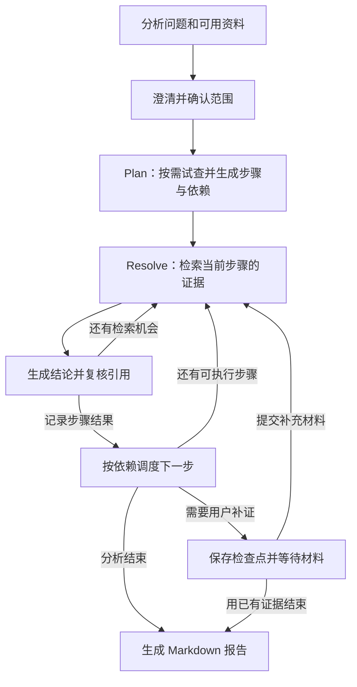

# TicketResolve 工单调查 Agent

Analysis Agent 是集成到开源客服平台 ChatterMate 的工单调查功能。经办人在原有工单详情页发起分析、上传材料和确认范围，系统按计划调查并生成带证据的结论，审核后将结果写回同一张工单的内部活动。

**典型场景：核对合同付款。** 系统读取合同条款和只读 MySQL 台账，分别确认应付金额、实付金额和差额。经办人可以点开每项结论查看合同原文行号或台账记录编号。证据不足时可上传补充材料。若台账查询中断，可从失败步骤续跑，复用已核实的合同条款。

## 新增能力

| 能力 | 在工单里可以做什么 |
| --- | --- |
| 通用分析与合同核对 | 自定义分析需求，或使用合同付款核对模板。通用分析支持多轮澄清和确认范围。 |
| 多源取证 | 上传 TXT 或 Markdown。按需查阅公开网页、管理员配置的资料目录和只读数据库。文档支持关键词或混合检索。 |
| 逐项复核与补证 | 查看每项结论的核实状态和引用。补证后重查受影响的步骤，展示变化前的结论和可复用的结果。 |
| 失败续跑 | 通过调查编号关联 LangGraph 检查点，恢复中断的步骤。 |
| 审批与报告 | 下载 Markdown 报告。经授权的经办人按所审阅的报告版本确认，将结论写入工单内部活动。 |

常用管理界面提供简体中文，包括工单、收件箱、助手、知识库和设置。部分高级配置及第三方提示仍可能使用英文。

## 集成架构

| 模块 | 技术与职责 |
| --- | --- |
| ChatterMate 社区版 | Vue 3、TypeScript 和 PostgreSQL。复用工单、组织权限和活动记录，新增调查面板和任务队列。 |
| Analysis Agent | Python、FastAPI、LangGraph 和 DeepSeek API。负责澄清需求、按依赖规划执行、检索和复核证据。 |
| 调查队列与检查点 | ChatterMate Worker 通过 FastAPI 调用分析引擎。PostgreSQL 保存调查队列，MySQL 保存 LangGraph 检查点。合同付款台账走独立的只读业务连接。 |

分析引擎采用 Plan-and-Execute，以 LangGraph 固定步骤依赖并调度执行，自适应取证在步骤内结合 ReAct 风格工具调用与复核反馈继续补查，人工补证和审批通过 HITL 参与。

工单经办人从 ChatterMate 发起调查。原生客服会话继续由 ChatterMate 管理，独立的调查引擎按工单请求执行。

## 本地运行

- **完整工单体验**。先按 Windows 本地部署说明配置 Docker、数据库、DeepSeek 和服务桥接。完成后双击 `ChatterMate/start-local.cmd`，从工单详情打开「工单分析（Analysis Agent）」。[本地运行说明](ChatterMate/CONTRACT_INVESTIGATION.md)

本仓库根目录包含分析引擎，`ChatterMate/` 包含集成后的社区版源码。保留 ChatterMate 的上游许可及署名。[工作台源码](ChatterMate/) · [上游许可](ChatterMate/LICENSE) · [上游署名](ChatterMate/NOTICE)


## 评测结果

2026-11-13 基线使用 `deepseek-flash` 对 12 道虚构文档题各运行一次关键词检索与混合检索，同一题使用相同的文档和评分标准。

| 指标 | 关键词 | 关键词 + BGE |
| --- | ---: | ---: |
| 答案、证据状态及引用符合预期 | 4/12 | 11/12 |
| 召回全部所需原文行 | 2/10 | 9/10 |
| 正确识别证据不足 | 2/2 | 2/2 |
| 单题耗时中位数 | 1.65 秒 | 4.91 秒 |

另有 6 道流程题，首次运行通过 5 道。跨进程补证恢复了原计划和已有结论，但计划中多余的一步使任务仍待补证。该题单独复测时生成了两步计划，补证后完成。文档组的混合检索漏过一道需要合并两处原文的题。以下报告记录每组通过情况、评分口径及复跑环境。[实跑报告](evaluation/baseline.md) · [运行说明与样例数据](evaluation/README.md)

后续加入逐项证据复核、计划目标去重和相邻原文召回。[优化与复测记录](evaluation/optimization-2026-11-15.md)

增加 DeepSeek 有限重试和任务级阶段追踪。五个故障注入场景已用真实 MySQL 检查点验收，独立文档集的混合检索通过 7/8 道。[失败恢复与独立评测](evaluation/reliability-2026-11-15.md)

## 单独运行分析引擎

在装有 Git 和 Python 3.12 的 Windows 上打开 PowerShell。先确认 `python --version` 显示 Python 3.12。如果 Python 未加入 PATH，可以用 Python 3.12 解释器的完整路径执行创建虚拟环境的命令。离线演示使用内置文档，无需 MySQL 和 DeepSeek API Key。

```powershell
git clone https://github.com/m0nesy1130-creator/chattermate-ticket-investigation.git
Set-Location chattermate-ticket-investigation
python -m venv .venv
& '.\.venv\Scripts\python.exe' -m pip install -r requirements.txt
& '.\.venv\Scripts\python.exe' -X utf8 -m app.demo
```

预期输出一份 Markdown 报告。结论为「试点工期为 30 天，从立项次日开始计算」，引用内置示例第 2 行 `L2`。

如需分析自己的 UTF-8 Markdown 或文本文件，可从仓库目录执行下面的命令，并将路径和关键词换成实际值。

```powershell
& '.\.venv\Scripts\python.exe' -X utf8 -m app.demo --file '.\contract.md' --question '维护年费'
```

## 分析引擎独立控制台

控制台的离线和 DeepSeek 模式都使用 MySQL 保存任务检查点。已有检查点库和凭据的用户可以直接启动。全新环境可在本机 MySQL 8.4 中用管理员账号执行以下 SQL。先把示例密码换成自己设置的密码。

```sql
CREATE DATABASE analysisagent CHARACTER SET utf8mb4;
CREATE USER 'analysis_agent'@'127.0.0.1' IDENTIFIED BY 'REPLACE_WITH_YOUR_PASSWORD';
GRANT SELECT, INSERT, UPDATE, DELETE, CREATE, ALTER, INDEX
    ON analysisagent.* TO 'analysis_agent'@'127.0.0.1';
```

在启动服务的同一个 PowerShell 中配置连接。下面的设置使用示例库名，连接 `127.0.0.1:3306`，账号为 `analysis_agent`。首次创建任务时，程序会在这个库里初始化检查点表。

```powershell
$env:ANALYSIS_AGENT_MYSQL_DATABASE = 'analysisagent'
$env:ANALYSIS_AGENT_MYSQL_PASSWORD = [System.Net.NetworkCredential]::new('', (Read-Host 'MySQL 检查点账号密码' -AsSecureString)).Password
```

如果要体验 DeepSeek 模式，在同一个窗口设置 API Key。

```powershell
$env:DEEPSEEK_API_KEY = [System.Net.NetworkCredential]::new('', (Read-Host 'DeepSeek API Key' -AsSecureString)).Password
```

从仓库目录启动控制台。

```powershell
& '.\.venv\Scripts\python.exe' -m uvicorn app.api:app --host 127.0.0.1 --port 8000
```

- [网页控制台](http://127.0.0.1:8000/)用于新建任务、确认范围、提交补证和下载 Markdown。
- [FastAPI 接口文档](http://127.0.0.1:8000/docs)提供创建任务、查询状态和续跑等接口。
- 使用其他 MySQL 地址或账号时，按需设置 `ANALYSIS_AGENT_MYSQL_HOST`、`ANALYSIS_AGENT_MYSQL_PORT` 和 `ANALYSIS_AGENT_MYSQL_USER`。Windows 用户若沿用应用的默认连接 `127.0.0.1:3306 / analysis_agent / analysis_agent_checkpoint`，也可以交互运行 `& '.\.venv\Scripts\python.exe' -m app.credentials`，将 MySQL 密码和 DeepSeek API Key 存到 Windows 凭据管理器。
- DeepSeek 模式默认使用 `deepseek-flash`，可用 `DEEPSEEK_MODEL` 指定模型。第一次开启混合检索时会下载本地 BGE 模型。

启动后，可以用一个虚构合同体验网页流程。新建一个 UTF-8 文件 `contract.md`，写入以下内容。

```markdown
# 虚构维护合同
维护年费为 12000 元。
```

上传文件，把「分析问题」填为「维护年费」，选择「离线摘录」并创建任务。按页面提示确认分析范围，即可核对报告里的金额、原文行号，并下载 Markdown。需要体验多轮澄清、多步分析或互联网与数据库联合检索时，切换到 DeepSeek 模式。

## Agent 如何工作

启用多步分析时，Agent 按步骤依赖推进任务。



- **规划与执行**。启用「根据证据补查」后，Plan 可以先查看可用证据，再生成并固定计划。Resolve 按步骤依赖执行，根据复核反馈追加检索动作和证据。需要用户澄清或补证时，LangGraph 保存任务状态，服务重启后可用原任务编号继续。
- **证据与报告**。支持上传 UTF-8 `.md`、`.txt`，或指定本地目录并选择是否扫描子目录。DeepSeek 模式可按需搜索公开网页，读取原文，并查询一个预配置的 MySQL 表或视图。报告区分直接支持、推断、缺证和冲突，并保留引用来源。
- **检索与上下文**。文档检索可将关键词与本地 BGE 向量结合，向量索引保存在 `runtime/rag`。DeepSeek 调用前会检查 12,000 token 的输入预算，裁剪时优先保留待复核的原文引用。
- **项目记忆**。按项目保存通过复核且能追溯到本次文档的工作记忆和抽象记忆，分别保留 7 天和 21 天。召回后重新检查原文版本和行号，再作为报告证据。

查看[多来源分析](docs/multi-source.md)了解公开网页检索和通用 MySQL 表配置，查看[MySQL 付款核对](docs/mysql-payments.md)了解台账字段和只读账号配置。检查点库用于写入任务状态，业务数据源使用单独的只读账号。

控制台面向本机使用。开启 DeepSeek 后，问题和相关证据片段会发送给 DeepSeek。运行数据和模型缓存放在 Git 忽略的 `runtime/` 目录。

## 代码入口与测试

| 文件 | 作用 |
| --- | --- |
| [app/api.py](app/api.py)、[app/web/](app/web/) | FastAPI 接口和本地网页控制台 |
| [app/graphs.py](app/graphs.py)、[app/planning.py](app/planning.py)、[app/execution.py](app/execution.py) | LangGraph 流程、计划验证和按依赖执行 |
| [app/adaptive.py](app/adaptive.py)、[app/evidence.py](app/evidence.py) | 按证据选择检索动作，生成和复核结论 |
| [app/checkpoints.py](app/checkpoints.py)、[app/memory.py](app/memory.py) | MySQL 检查点和项目记忆 |
| [app/report.py](app/report.py) | 汇总证据与结论，输出 Markdown |

```powershell
& '.\.venv\Scripts\python.exe' -m unittest discover -s tests -v
```

自动测试覆盖需求确认、目录扫描、步骤依赖和续跑、证据复核、SQL 查询边界及付款差额计算。

配置 DeepSeek 凭据后，可以从仓库根目录复跑文档评测。完整流程题还需要本机 MySQL 和示例业务数据。[评测配置](evaluation/README.md)

```powershell
& '.\.venv\Scripts\python.exe' -X utf8 -m evaluation.run --suite documents
```
